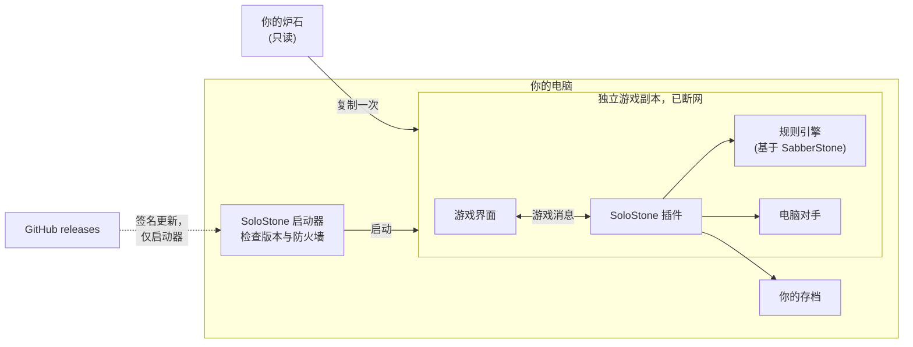

已经可以在Mac m芯片下流畅玩了。

# SoloStone

> [!WARNING]
> **Alpha 0.4.0。** SoloStone 还在早期试玩阶段，可能出现 bug 和卡进度的问题。欢迎反馈：
> 遇到任何问题请到 [Discord](https://discord.gg/e45QgKHmC2) 告诉我们，或提一个
> [issue](https://github.com/wooluo/SoloStone-Mac/issues)。

> [!NOTE]
> **作者的话。** SoloStone 是一个人的业余项目，代码和文档都还比较粗糙：目前它是以"能跑"为目标写出来的，
> 还没顾上好看。如果真的有很多人想玩，我会投入更多精力去清理。我同时还有全职工作和家庭，
> 经常很累，回复可能不及时，感谢耐心。

SoloStone 是一个非官方的《炉石传说》单机离线 mod。它需要你自己合法获取的炉石客户端。本项目与暴雪娱乐无关，未获得其认可或赞助。Hearthstone 是 Blizzard Entertainment, Inc. 的商标或注册商标。

**在你自己的电脑上离线玩炉石，对战电脑对手。** 游戏本体的界面、天梯和休闲对局、组卡、开包与进度，全部保存在你的机器上。

[只想开玩？](#只想开玩) · [工作原理](#工作原理) · [参与贡献](#参与贡献) · [从源码构建](docs/BUILDING.md) · [运行测试](docs/TESTING.md)（[测试体系说明](docs/TESTING-GUIDE.md)）

[English](README.en.md) | **简体中文**

## 只想开玩？

你需要 Windows 10 或 11（64 位）、通过 Battle.net 安装的炉石、约 12.5 GB 空闲空间。

1. **退出 Battle.net**：右键托盘图标，选**退出**。每次玩之前都要做。
2. 从[最新 release](https://github.com/wooluo/SoloStone-Mac/releases/latest) 下载 **`SoloStone-Setup-0.4.0.exe`**。
3. 运行。Windows 会弹蓝色**"Windows 已保护你的电脑"**页面，因为安装器没有付费的代码签名证书。
   点**更多信息**，再点**仍要运行**。
4. 跟着五步设置走。Windows 请求权限时（添加防火墙规则）点**是**。
5. 从桌面或开始菜单快捷方式启动 **SoloStone**，点**开始游戏**。

出了问题？到 [Discord](https://discord.gg/e45QgKHmC2) 反馈。完整指南见 [INSTALL.md](docs/INSTALL.md)。

## 这是什么

- **一个套在你游戏副本上的 mod。** SoloStone 复制你已有的炉石，往副本里加入自己的文件，并阻止副本联网。你原本的炉石目录只读不写。
- **一个本地单机游戏。** 电脑对手有各自的卡组、水平和性格。你在本地天梯爬分、组卡、开包，靠打对局赚奖励。
- **一套固定的卡池。** 首个版本采用《黑色帝国统治》上线前夕的标准模式（文件里叫"紫罗兰监狱环境"）。不跟随后续平衡补丁。

## 这不是什么

- **不是联机。** 没有服务器、没有匹配、没有多人。SoloStone 从不登录任何地方。
- **不是获取炉石的途径。** 你得先通过 Battle.net 装好炉石。SoloStone 不附带任何炉石程序文件、美术或音频。
- **不收钱。** SoloStone 不以任何形式向任何人收钱。

卡牌数据文件包含取自游戏的卡名和英文卡牌文本，版权归暴雪。[NOTICE](NOTICE) 说明了具体内容与位置。

**版权方：** 如果你代表暴雪娱乐或其他版权方，对本项目或其中任何部分有异议，请写信到 KirillLoves@proton.me。我会尽快回复，协商解决。

## 工作原理

1. **安装。** 设置程序把你的炉石复制到 `%LOCALAPPDATA%\SoloStone\client`，加入 mod 文件，并请
   Windows 阻止副本内所有程序联网。
2. **启动。** 启动器检查你的客户端版本和防火墙规则，然后启动副本。
3. **加载。** 标准 Unity mod 加载器（[BepInEx](https://github.com/BepInEx/BepInEx)）在游戏内加载
   SoloStone 插件。插件只在内存里改动游戏代码，每次游戏启动时重新生效。磁盘上，副本获得 mod 文件
   和自己的公司名，所以它的设置与你的炉石互不干扰。
4. **对局。** 在游戏原本要与暴雪服务器通信的地方，插件代为应答：
   - 你的操作交给本地**规则引擎**（基于开源
     [SabberStone](https://github.com/HearthSim/SabberStone) 模拟器）；
   - 引擎的结果以服务器消息同样的格式返回，游戏自己的界面照常显示；
   - **电脑对手**只能看到真实玩家能看到的信息来决策：不偷看你的手牌，不发牌作弊。
5. **存档。** 你的收藏、卡组、天梯和奖励保存在本地（`%LOCALAPPDATA%\SoloStone\saves`）。
   奖励先落盘再展示，存档有备份，崩溃不会丢或重复。

**安全检查。** 防火墙规则缺失、检测到网络连接、或游戏版本无法处理时，SoloStone 拒绝启动。你原本的炉石、Battle.net 程序和账号永远不被触碰。

## 可以期待什么

- **这是 alpha。** 有毛边，只在少数机器上测过。
- **目前仅 Windows**，基于炉石客户端 37.0.0.254477 测试。Steam Deck 和 Linux 暂不支持。
- **Windows 只请求一次权限**，用于添加防火墙规则。
- **炉石更新时：**

  | 你的客户端变化 | SoloStone |
  |---|---|
  | 小补丁 | 照常工作，无提示 |
  | 中等更新 | 弹一个可以点掉的警告 |
  | 大版本 | 等待匹配的 SoloStone 版本；已装的副本继续可玩 |

- **SoloStone 自身的更新**只通过启动器下发，在游戏启动前进行，并校验签名。可以关闭。
  [INSTALL.md](docs/INSTALL.md) 列出了所有联网行为。
- **卡牌文本**来自 SoloStone 自己的数据文件，只有英文，所以可能与更新后的客户端或线上不同。

## 参与贡献

**欢迎提 issue 和 PR**（[CONTRIBUTING.md](.github/CONTRIBUTING.md)：提交须 sign-off，CI 跑公开测试）。最有用的帮助：

| 你可以 | 方式 |
|---|---|
| 报 bug | 提 [issue](https://github.com/wooluo/SoloStone-Mac/issues)：写清 SoloStone 和炉石版本、做了什么、期望什么、实际发生什么 |
| 报卡牌/规则错误 | 写明卡牌（或 ID）、实际效果和正确效果。附来源链接更好 |
| 说对手打得蠢 | 描述它的操作，以及好玩家会怎么做 |
| 自己构建 | [BUILDING.md](docs/BUILDING.md)。需要你自己的炉石客户端作为参考库 |
| 提交修复 | PR，每个 commit 都 sign-off：[CONTRIBUTING.md](.github/CONTRIBUTING.md)、[GIT.md](docs/GIT.md) |
| 报安全问题 | [SECURITY.md](.github/SECURITY.md)。不要发公开 issue |

请不要贴账号信息、密码或 token，不要附游戏文件或卡牌美术。日志可能包含你的 Windows 用户名，先检查再发。

聊天：[Discord](https://discord.gg/e45QgKHmC2)

### 还没有的

- **公开的只是测试套件的一部分。** 卡牌、规则、对手 AI、开包、天梯和启动器测试都在这里并在
  GitHub 上跑（[TESTING.md](docs/TESTING.md)）。需要你自己的炉石客户端的测试也在，作为 `client`
  层自己跑；但其中一些需要尚未发布的工具导出的卡牌数据。真机上的实测保持私有，所以你在这里的改动
  不被它们检查。
- **还没有 mod API 或开发者模式。** 有需求的话会认真设计。在那之前，mod 就是在你自己的 fork 里
  叠在我们补丁上的一组补丁。

### 仓库结构

| 目录 | 内容 |
|---|---|
| `engine/` | 规则引擎：修改版 SabberStone（AGPL），含新卡机制 |
| `plugin/` | 游戏内运行的插件：游戏消息、界面、对手、存档 |
| `installer/` | 安装器和启动器（`SoloStone.exe`）及其测试 |
| `tests/` | 公开测试套件与一键运行（[TESTING.md](docs/TESTING.md)） |
| `sim/HsSim/` | golden-game 和随机对局测试背后的无头模拟器 |
| `research/` | 测试和模拟器用的两个小证据卡组文件 |
| `facts/` | 固定卡池的卡牌数据，一个 meta 一个文件 |
| `data/` | 对手卡组与人设、卡池、商店、卡包和进度数据 |

分支与提交命名：[GIT.md](docs/GIT.md)。

## 来源与许可

每个下载的源码都在本仓库对应 release 的 tag 里。[BUILDING.md](docs/BUILDING.md) 说明如何构建。

SoloStone 自身代码以 GNU AGPL 3.0 或更高版授权（[LICENSE](LICENSE)），其自有文件附加一项许可
（[LICENSE-ADDITIONAL-PERMISSION.md](LICENSE-ADDITIONAL-PERMISSION.md)）。规则引擎基于同为 AGPL 的
SabberStone。其他人的作品及其许可见 [NOTICE](NOTICE)。

---

**语言 / Languages**：[English](README.en.md) · 简体中文（当前）
